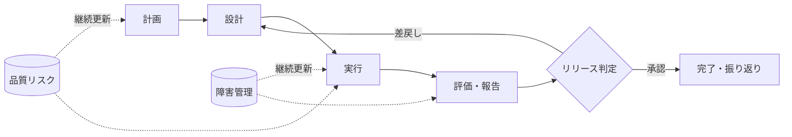

# QAライフサイクル

QAは不具合の件数を数えるだけでなく、利用者・事業・運用へのリスクを見える化して判断を支える活動です。

| 工程 | 目的 | ゲートで確認すること |
| --- | --- | --- |
| 計画 | 対象、方法、品質基準を合意する | 範囲、リスク、体制、環境、完了条件 |
| 設計 | 要件に基づく確認観点を作る | 要件との対応、データ、期待結果、レビュー |
| 実行 | 結果と障害を再現可能な形で残す | 実行状況、証跡、障害の優先度・再現性 |
| 評価・報告 | 品質状況と残存リスクを伝える | 基準達成、未実施範囲、重大障害、推奨判断 |
| 終結 | 学びを次回へ活かす | 引継ぎ、改善アクション、完了承認 |

小規模案件では文書を統合して構いませんが、テスト対象、期待結果、実行結果、判定根拠は区別して残します。
