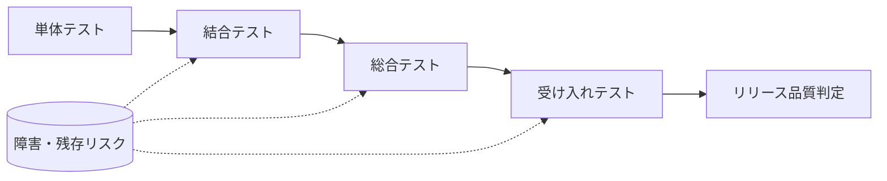

# テストレベルの使い分け

単体、結合、総合、受け入れテストは重複する部分があっても、確認する責任と判断が異なります。案件の規模に応じて統合して構いませんが、各レベルで何を確認し、誰が結果を判断するかをテスト計画に記録してください。

| レベル | 目的 | 主な確認内容 | 主な実施者 | 主な成果物 |
| --- | --- | --- | --- | --- |
| 単体テスト | 個々の部品の正しさを確認 | 正常・異常値、境界値、例外、部品単位の仕様 | 開発担当 | 単体テスト計画、実行結果 |
| 結合テスト | 部品・外部サービスの接続を確認 | インターフェース、データ連携、認可、エラー連携 | 開発・QA | 結合テスト計画、障害票 |
| 総合テスト | システム全体の品質を確認 | 主要業務フロー、非機能、運用、回帰 | QA | 総合テスト計画、品質報告 |
| 受け入れテスト | 利用者・顧客の受入条件を確認 | 実業務シナリオ、受入基準、移行・教育・運用準備 | 利用部門・顧客 | 受け入れテスト計画、受入・リリース品質判定 |

## レベル間の引継ぎ

前工程で見つかった障害の修正は、修正確認だけでなく、影響範囲に応じた回帰確認を行います。次のレベルへ進めない未解決事項は、影響、回避策、担当、判断期限を品質報告へ記録します。
